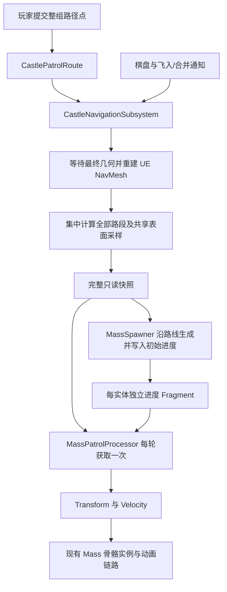
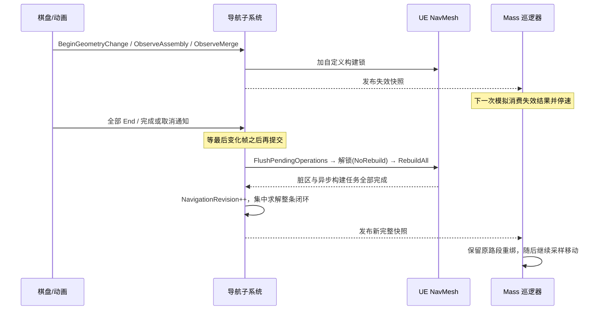

# NPC 共享导航技术设计

本文是 NPC 共享巡逻、NavMesh 更新调度及 Mass 跟随的长期技术文档，面向后续维护者和 agent。修改相关实现时，应同步维护本文中的行为契约、源码入口、限制和验证方法。

最近源码核对：2026-11-11。首次整理基于 `f75e751` 的实现；该提交号用于追溯，不代表后续维护应停留在此版本。文档与源码不一致时，先核对当前源码和用户设计，再同时修正文档与实现，不能把本文中的“后续扩展”当成已实现功能。

配套资料：[配置与直接验收](NPC共享导航.md)、[Mass 单位框架](../Mass/Mass单位框架.md)、[建筑功能分支 GameplayRoot](../Animation/GameplayRoot.md)。本文件负责系统设计与维护契约，前者负责关卡作者和玩家操作。

## 1. 目标、范围与必须保留的契约

玩家提交有序路径点 `W1…WN`。系统一次集中计算 `W1→W2、W2→W3、…、WN→W1` 的所有路段，全部成功后发布完整闭环。所有 Mass NPC 共享这份结果，只独立保存行走进度。

“全局一次计算”指一次完整批次：N≥2 时调用 UE 最短路查询 N 次，其中包含返回起点的一段。它不表示只调用一次原生寻路，也不表示预计算所有点对的 N² 路径。玩家指定的顺序固定，不执行路径点重排或旅行商求解。

维护时必须保留以下契约：

1. NPC 到达路径点、转弯或完成一圈时均不寻路；NPC 数量不影响集中最短路查询次数。
2. 先计算完整闭环，再发布可用快照。任一必要路段失败，整条新路线无效，不能发布前几段、部分路径或假装沿用可行的旧路线。
3. 建筑几何开始变化时使路线失效；整轮放置、飞入、合并结束后才允许刷新 NavMesh 和集中重算。
4. 已发布快照不可原地修改。持有旧指针只保证数据仍存在，不保证旧路线仍可通行。
5. Mass 实体不保存各自的路径数组、NavMesh 多边形引用、AIController 或逐实体寻路任务。
6. 当前运行逻辑在 C++；蓝图/关卡资产承担配置，不承载另一套巡逻实现。
7. 不可达、配置错误或重绑失败要有反馈，不能静默改为直线穿墙、远距离传送或其他未设计行为。

N=1 是有效的单点待命路线，不执行自身到自身的寻路；N=0 是无效请求，清空应使用 `ClearSharedRoute()`。

## 2. 模块划分与源码导航

所有下列源码链接均相对本文位置，随仓库/worktree 移动仍可使用。定位行为优先使用类名和函数名，不依赖易过期的行号。

| 责任 | 源码与关键入口 |
| --- | --- |
| 唯一请求、导航构建调度、集中计算、快照发布 | [CastleNavigationSubsystem.h](../../Source/Moving_Castle/Units/Navigation/CastleNavigationSubsystem.h)、[.cpp](../../Source/Moving_Castle/Units/Navigation/CastleNavigationSubsystem.cpp)：`RequestRoute`、`CalculateSharedPath`、`PublishPath`、`Tick` |
| 共享数值结构与采样 | 同上：`FCastleSharedNavigationPath`、`SamplePatrol`、`FindClosestPatrolDistance`、`FindPatrolLeg`、`CastlePatrolNavigation::AppendSurfaceSamples` |
| 每个 NPC 的独立巡逻状态 | [CastleMassPatrolFragments.h](../../Source/Moving_Castle/Units/Navigation/Mass/CastleMassPatrolFragments.h)：`FCastleMassPatrolFragment` |
| 并行跟随、暂停与重绑 | [CastleMassPatrolProcessor.cpp](../../Source/Moving_Castle/Units/Navigation/Mass/CastleMassPatrolProcessor.cpp)：`UCastleMassPatrolProcessor::Execute` |
| 沿路线批量生成及初始进度 | [CastleMassSpawner.cpp](../../Source/Moving_Castle/Units/Mass/CastleMassSpawner.cpp)：`SpawnUnits`、`HandleSharedRouteReady` |
| 外部单位命令与状态查询 | [CastleMassUnitSubsystem.h](../../Source/Moving_Castle/Units/Mass/CastleMassUnitSubsystem.h)、[.cpp](../../Source/Moving_Castle/Units/Mass/CastleMassUnitSubsystem.cpp)：`FollowSharedPatrolRoute`、`MoveUnitsTo`、`SetUnitsVelocity`、`StopUnits`、`GetUnitSnapshot` |
| NPC 模板组成与普通移动互斥 | [CastleMassTraits.cpp](../../Source/Moving_Castle/Units/Mass/CastleMassTraits.cpp)、[CastleMassProcessors.cpp](../../Source/Moving_Castle/Units/Mass/CastleMassProcessors.cpp) |
| 玩家路径点、草稿、输入与调试绘制 | [CastlePatrolRoute.h](../../Source/Moving_Castle/Units/Navigation/Interaction/CastlePatrolRoute.h)、[.cpp](../../Source/Moving_Castle/Units/Navigation/Interaction/CastlePatrolRoute.cpp)：`ACastlePatrolRoute` |
| 正式控制器入口与验收生成命令 | [CastlePlayerController.cpp](../../Source/Moving_Castle/Castle/Controllers/CastlePlayerController.cpp)、[CastlePatrolController.cpp](../../Source/Moving_Castle/Units/Navigation/Interaction/CastlePatrolController.cpp) |
| 棋盘同步几何变化 | [CastleBoard.cpp](../../Source/Moving_Castle/Castle/Actors/CastleBoard.cpp)：`FScopedCastleNavigationChange` 的使用位置 |
| 飞入、合并的整轮变化通知 | [AssemblyFlightComponent.cpp](../../Source/Moving_Castle/Components/Animation/AssemblyFlightComponent.cpp)、[BuildingMergeComponent.cpp](../../Source/Moving_Castle/Components/Animation/BuildingMergeComponent.cpp) |
| 建筑导航输入资格 | [BuildingNavigationActor.cpp](../../Source/Moving_Castle/Castle/Actors/BuildingNavigationActor.cpp)、[BuildingGameplayRootComponent.h](../../Source/Moving_Castle/Components/Building/BuildingGameplayRootComponent.h) |
| 棋盘显示地块的碰撞/导航设置 | [CastleGroundTileActor.cpp](../../Source/Moving_Castle/Castle/Actors/CastleGroundTileActor.cpp)：`InitializeGroundCell` |
| 引擎配置和模块依赖 | [DefaultEngine.ini](../../Config/DefaultEngine.ini)、[DefaultMass.ini](../../Config/DefaultMass.ini)、[Moving_Castle.Build.cs](../../Source/Moving_Castle/Moving_Castle.Build.cs) |



`UCastleNavigationSubsystem` 只存在于 Game / PIE 世界。不同 PIE 世界分别拥有各自的请求和快照，不跨世界共享指针或句柄。编辑器非 Play 世界不提供这套运行时导航服务。

## 3. 数据模型、坐标与版本

### 3.1 路径点、转折点和表面采样

| 数据 | 所属对象 | 含义与坐标 |
| --- | --- | --- |
| `LocalWaypoints` | `ACastlePatrolRoute` | 相对该 Actor 的作者配置，BeginPlay 时变换到世界坐标；支持编辑器三维手柄 |
| `DraftWaypoints` | `ACastlePatrolRoute` | 本次玩家编辑草稿，世界坐标；Enter 前不替换请求 |
| `RequestedWaypoints` | 导航子系统 | 已接收请求的原始世界坐标，尚不等于有效 NavMesh 落点 |
| `Waypoints` | 共享快照 | 投影后的玩家路径点，仍保持玩家顺序 |
| `Points` / `PointFlags` | 共享快照 | UE 各段路径的转折点及引擎标记；不是玩家路径点，也不是逐台阶高度采样 |
| `PatrolPoints` / `PatrolDistances` | 共享快照 | 整条闭环的表面采样及对应累计距离，是 Mass 实际消费的数据 |
| `WaypointDistances` | 共享快照 | 每个玩家路段的距离边界，含额外的闭环终点 |

不能通过 `Points.Num()` 推断玩家设置了几个点，也不能把 `PatrolPoints` 的每个采样当作需要到达并停顿的玩家目标。

有效巡逻快照的关键约束：

- `bValid=true` 且 `bClosedLoop=true`，才能由巡逻 Processor 消费。旧单段调试路径可以有效，但 `bClosedLoop=false`。
- `PatrolPoints.Num() == PatrolDistances.Num()`，且至少有一个采样。
- `PatrolDistances[0]=0`；后续非退化采样距离严格增加；`Length=PatrolDistances.Last()`。
- N≥2 时，采样路线含最后一段 `WN→W1`，首末位置形成闭环；`WaypointDistances` 有 N+1 个元素，首项 0、末项 `Length`。
- 单点路线只有一个 `PatrolPoint`，`Length=0`，`WaypointDistances=[0,0]`。生成多个 NPC 会让它们位于同一待命点，当前没有分散站位。
- 巡逻 `Length` 使用表面采样折线的三维累计长度，不直接沿用原生转折点路径的长度。旧单段请求仍使用原生路径长度。
- 计算失败时清空转折点、标记、巡逻采样及距离数组，长度归零；`Waypoints` 可能保留已投影的点用于描述此次请求，不能绕过 `bValid` 使用它们移动。

`PatrolDistances` 和 `WaypointDistances` 当前是 C++ 数组，没有 UPROPERTY 反射；蓝图不能直接使用它们作为一套跟随实现，默认 UObject 序列化也不负责保存这两组运行数据。本结构及实体状态尚未定义存档格式。

运行时编辑不会自动保存回 `.umap`。移动路线 Actor 也不会自动重新提交已接收的世界坐标请求；需要通过正式入口重新提交点列。

### 3.2 三种版本号

| 版本 | 递增时机 | 主要用途 |
| --- | --- | --- |
| `NavigationRevision` | 一轮受调度的 NavMesh 构建确认完成 | 标识本轮导航几何结果 |
| `RouteRevision` | 接收不同的原始点列/闭合模式，或执行清空 | 区分“同一路线因网格重算”和“玩家换了路线” |
| `PathRevision` | 每次 `PublishPath`，包括失效或失败结果 | 通知消费者更换当前快照并决定是否重新绑定进度 |

三个计数不是同一概念，不要求相等，也不能用路线未变推断导航未变。通用 `InvalidatePath` 仅在当前快照有效时额外发布失效快照；当前已无效/尚无快照时不会反复发布。该临时失效结构不保证保留旧路线字段和 `RouteRevision`，因此版本比较必须在确认拿到有效闭环之后进行。

`ClearSharedRoute` 每次都会递增路线版本并发布失效结果，即使原先已清空。相同请求命中缓存不递增路线版本，也不增加查询次数。

### 3.3 共享所有权与线程边界

`PublishedPath` 的类型是 `TSharedPtr<const FCastleSharedNavigationPath, ESPMode::ThreadSafe>`。`PublishPath` 在游戏线程构造新对象，以 `FRWLock` 替换指针，释放写锁后广播无参数的 `OnSharedPathChanged`。监听者应重新获取快照，事件本身不携带路径。

`AcquireSharedPath()` 在读锁内复制共享指针，多个消费者拿到同一个只读对象。`GetSharedPath()` 返回整个结构副本，适合界面和少量调试；不要逐 NPC、逐帧调用它复制数组。`GetRequestedWaypoints()` 返回子系统内部数组的引用，供游戏线程编辑入口使用，不是给工作线程持有的数据接口。

巡逻 Processor 以 `bRequiresGameThreadExecution=true` 进入 `Execute`，取得一次快照后按 Chunk 并行处理。工作线程只读取捕获的不可变数据与当前 Chunk 的 Fragment，不访问导航 UObject，不执行投影、射线或寻路。`NewlyBlocked` 用原子计数汇总，日志和屏幕反馈回到 Processor 的游戏线程部分处理。

## 4. 整条闭环的请求、计算与发布

### 4.1 请求接收和缓存

`RequestSharedPatrolRoute` 调用内部 `RequestRoute(Waypoints, true, Failure)`；旧 `RequestSharedPath(Start, Goal, Failure)` 调用同一个入口但闭合标记为 false。两种请求共享一个槽位，会互相替换；不能在正在巡逻的世界中用旧调试入口请求另一条路线并期望两者共存。

接收前同步检查：

1. 点列非空，坐标为有限值。
2. `ProjectionExtent` 有效且各轴大于 0；`PatrolSampleSpacing` 为有限值且至少 1 cm。
3. 相邻原始点不能在 `FVector::Equals(..., 1.0)` 的容差内重合，包含末点和首点。
4. 世界已有默认导航数据，且运行时生成模式为 `Dynamic`。

这些检查失败时返回 false，通过输出 `Failure` 说明原因，不替换当前请求。它们与已接收请求后发生的投影/不可达失败不同。

缓存键为原始世界坐标点列的精确数组相等和闭合模式。投影后相同但原始坐标不同，仍视为新请求。`ProjectionExtent`、采样间距没有包含在缓存键中；修改这些参数后，应显式请求导航刷新，或清空后重新提交，不能仅重复相同点列期待重算。

新请求接收后递增 `RouteRevision`，标记 `bPathPending` 并使旧有效路线失效。导航已就绪时立即同步计算；正在变化/构建时等待调度。首次请求若尚无本服务完成的导航版本，会排队一轮初始刷新。

**返回 true 仅代表请求被接收，不保证此刻或最终可达。** 即使同步集中计算已经失败，接收接口仍可返回 true；调用方需读取新快照、事件和 `LastFailure`。同一份已失败请求再次命中缓存，也不会自行重试；排除问题后可 `RequestNavigationRefresh`，或清空并重新提交。

### 4.2 集中求解批次

`CalculateSharedPath` 使用一个尚未发布的临时结构，流程如下：

1. 重新确认导航数据可用，填入当前导航版本、路线版本与闭合标记。
2. 在有限 `ProjectionExtent` 内投影全部玩家路径点。任一点失败，就不执行本轮路段寻路。
3. 循环巡逻要求 `ARecastNavMesh`，以取得路径走廊和表面信息。单点只保留投影位置。
4. 对 N≥2 的点列，依序查询 `(i, (i+1) mod N)`，包含闭合段。投影后相邻点重合也会拒绝。
5. 每次实际调用 `FindPathSync` 前递增 `PathQueryCount`，设置 `SetAllowPartialPaths(false)`，只接收完整成功路径。
6. 对临时原生路径关闭 `EnableRecalculationOnInvalidation`，拼接转折点并去掉段接头的重复点。
7. 巡逻路径若包含 `CustomNavLinkId` 或 NavLink 标记，明确失败；当前没有执行对应动作的行为。
8. 沿每段已选走廊生成共享表面采样，记录每个玩家路段的距离边界。
9. 全部成功后令 `bValid=true` 并发布一次有效闭环；任一步失败则清空可移动数据，发布失败结果并记录原因。

N=2 仍分别求解 `W1→W2` 和 `W2→W1`，不能直接把去程倒过来使用；引擎区域代价和通行方向可能影响结果。

“最短”遵循 UE 默认导航过滤器的最小代价路径。区域代价相同的设计下按距离选择；引入不同代价的 NavArea 后，不应继续承诺纯几何距离最短。本文不把复杂三维空间上的数学最短曲线等同于 Recast 离散导航结果。

“原子发布完整结果”不表示一次业务操作只产生一个事件：替换旧有效路线可以先发布一次失效，再发布一次完整结果；中间绝不发布“前一段可用”的巡逻快照。当前寻路和采样在游戏线程同步完成，尚无异步路线作业或按段缓存复用。

### 4.3 共享表面采样

原生路径的转折点不能直接代表楼梯每一处高度。`AppendSurfaceSamples` 在集中计算阶段，按转折线段的二维长度和 `PatrolSampleSpacing`（默认 20 cm）划分采样，随后读取本段 `FNavMeshPath::PathCorridor` 上的表面位置。

对每个候选采样，代码在按走廊顺序限定的多边形范围中调用 `GetClosestPointOnPoly`。只接收水平偏离平方不超过 1 cm² 的候选，以水平偏离和相对上一采样的高度变化选择表面，再单向推进走廊游标。无法找到合法表面时失败，不退回连接高低两个转折点的悬空直线。

多边形引用只在本次计算期间使用，最终快照只保留世界坐标和距离；这避免 NavMesh Tile 重建后仍解引用旧多边形。采样的是 NavMesh 表面，不是每帧物理落地检测：体素高度和线性插值允许与美术/真实碰撞顶面存在误差，不能宣传为精确的物理脚底贴地或 CharacterMovement 台阶求解。

## 5. 建筑变化与 NavMesh 更新时序

### 5.1 变化范围和锁

同步变化使用 `FScopedCastleNavigationChange(World, Source)` 包住创建、替换或删除几何的代码。长生命周期变化使用同一来源配对 `BeginGeometryChange` / `EndGeometryChange`；飞入和合并分别通过 `ObserveAssembly` / `ObserveMerge` 复用原有整轮结束信号。

`Changes` 按弱来源保存嵌套深度，`ActiveChangeCount` 是全部未配对变化数。第一项变化加 `ENavigationBuildLock::Custom`，使当前路线失效。最后一个 End 仅排队，不在回调内立即解锁；提交至少晚于最后变化的帧号，使“飞入结束后同步触发自动合并”的回调能先登记下一段变化。



弱引用不等于自动结束变化：来源被销毁或动画取消时仍须走已配对的结束路径，否则计数可一直大于 0。已有组件包含完成、Reset 和 EndPlay 的清理，新增来源必须提供同等生命周期处理。

### 5.2 状态、完成判定与失败

以下状态是对现有字段组合的解释，代码中没有另一个状态枚举。

| 阶段 | 关键状态 | 调度行为 |
| --- | --- | --- |
| 稳定 | 没有待刷新、构建或路径请求 | 导航子系统停止 Tick |
| 几何变化中 | `ActiveChangeCount>0` | 持有构建锁；导航子系统本身不 Tick；等待业务完成通知 |
| 等待提交 | `bRefreshPending=true` 且计数为 0 | 等 `GFrameCounter>LastChangeFrame` |
| 构建中 | `bBuildingNavigation=true` | 等待导航脏区和异步生成任务 |
| 待求解 | `bPathPending=true` | `IsNavigationReady()` 为 true 后集中计算 |

提交时先 `FlushPendingOperations()` 将最终碰撞同步到导航八叉树，以 `NoRebuild` 方式移除自定义锁，再对默认导航数据调用一次 `RebuildAll()`，递增 `RefreshCount`。当前每轮是全局重建，未实现自己的局部 Tile 调度；底层异步生成仍由 UE 执行。

构建至少跨过必要帧间隔，并等待 `HasDirtyAreasQueued()`、`IsNavigationDirty()`、`IsNavigationBuildInProgress()` 均结束，才递增 `NavigationRevision`。超过 60 秒仍未完成时报告错误、停止这轮待办并释放本服务持有的锁，不持续重试。构建期间又开始几何变化时取消旧构建，把变化并入下一轮，旧结果不发布。

`IsNavigationReady()` 表示网格已稳定且有完成版本，不表示存在有效巡逻路线。反过来，也不要只看 `bBuildingNavigation=false` 就认为导航已就绪。

没有导航的纯逻辑世界仍可以使用原建筑逻辑，`BeginGeometryChange` 可以返回 false；但显式请求导航/巡逻会报告缺少默认导航数据。不会为此伪造路径或无限后台轮询。

`RequestNavigationRefresh()` 用于外部生成器只在完成时提供通知的场合；它会使路线失效并合并刷新请求，但不能事后补上生成期间缺失的构建锁。需要抑制动画/施工中间更新时，应使用开始/结束配对。

本服务没有监听任意外部 NavMesh 修改并自动发布失效结果的通用桥接。新增可移动阻挡体、动态 NavArea 或其他会改变通路/代价的业务，必须接入上述变化/刷新入口；仅让 UE 自行标记脏区，并不能保证共享快照及时失效和重算。

### 5.3 现有几何接入边界

`CastleBoard` 的地面生成、建筑放置、移除、直接销毁回调、合并等同步操作使用变化作用域；飞入和合并组件在起播时登记，在原生结束事件中释放。动画临时显示件先设置无碰撞和不影响导航，再赋 Static Mesh，避免组件创建中间态被导航记录。

建筑的导航输入由 `ABuildingNavigationActor::IsComponentRelevantForNavigation` 限定为 `UBuildingGameplayRootComponent` 自身及其后代。资格按类型和当前父级链判断，单纯命名 `GameplayRoot` 不生效；组件还必须自行提供正确碰撞并允许影响导航。外部美术分支、标签和辅助件不能靠勾选导航开关绕过这层过滤。

**当前棋盘地块不是单位导航表面。** `ACastleGroundTileActor` 构造及初始化均关闭 `CanEverAffectNavigation`；初始化后仅使用 QueryOnly 碰撞并阻挡 Visibility，其余通道忽略。移除建筑不会让地块恢复为导航面。因此“中心射线能点到棋盘”不代表“该处 NPC 能走”，连接的行走面必须由真正的功能楼板、楼梯等提供。

## 6. Mass 生成、进度和移动

### 6.1 Trait 和实体状态

`UCastleMassNPCTrait` 在原有公共人形组成外加入 `FCastleMassPatrolFragment`。敌人/子弹不会因此自动加入巡逻；仅添加 NPC Trait 也不会自动开启行为，`bEnabled` 默认 false。

| 实体字段 | 含义 |
| --- | --- |
| `bEnabled` | 此单位当前是否由巡逻器负责移动 |
| `bBlocked` | 当前有效快照的绑定是否失败；无路线等待不一定为 true |
| `PathRevision` / `RouteRevision` | 此单位已绑定的快照及路线版本，初值 `INDEX_NONE` |
| `Leg` | 当前玩家路段索引，从 0 开始，不是采样点下标 |
| `Distance` | 本圈累计距离；非退化闭环中保持 `[0, Length)` |
| `Speed` | 该单位巡逻速度标量 |
| `CompletedLaps` | 此轮启用巡逻以来的累计圈数，路线重算/重绑不清零；显式 Follow 命令重置，不是路径点到达次数 |

移动参数仍来自原有 `FCastleMassMovementParameters` 常量共享 Fragment。巡逻使用 MaxSpeed、Acceleration、TurnRate、bKeepUpright；普通直达移动的 AcceptanceRadius 不用于跳过巡逻转折点或提前截断闭环。

### 6.2 推荐入口：沿路线生成

`ACastleMassSpawner` 的巡逻配置为 NPC Configuration、`bFollowSharedPatrolRoute=true`、`bStartMoving=false`。默认在 BeginPlay 生成；关闭 `bSpawnOnBeginPlay` 时需由业务显式触发。Count 必须大于 0；当前统一校验也要求 Columns 和 Spacing 保持有效正值，尽管巡逻位置不采用网格排布。

完整闭环尚未发布时，生成器只订阅一次 `OnSharedPathChanged` 并记录等待状态，不 Tick，不为每个 NPC 发请求。此时 `SpawnUnits()` 返回 true 可以表示“已接受等待”，`SpawnedUnits` 仍可能为空。

闭环有效后取消订阅，为第 i 个单位设置：`Distance_i = Length × i / Count`，由 `SamplePatrol` 取得世界位置和方向，批量生成实体，再直接写入已知 Distance、Leg 和两个绑定版本。正式生成接口已检查 Mass 不在处理中，因此这里能在安全边界初始化 Fragment。

**必须保留精确初始进度，不能在生成后统一用最近位置反推。** 去程和返程可能经过同一段楼梯/走廊，空间最近点无法区分路线阶段，可能把返程单位绑定到去程。`9654416` 修正的就是这一问题。

生成器只负责本批初次生成，已生成后不会因路线编辑自动销毁、补齐或重新分布全部单位。后续变化由跟随器重绑处理；测试命令重新生成属于明确的用户操作。

### 6.3 已有单位加入与命令互斥

`UCastleMassUnitSubsystem::FollowSharedPatrolRoute(Units, Failure)` 要求游戏线程、Mass 处理之外、本世界非空批次，且整批句柄对应活跃实体并含 NPC 巡逻 Fragment。校验通过后以延迟命令重置巡逻 Fragment、启用巡逻、清空直达目标和实际速度，不发起寻路。

该入口不要求路线已就绪；无可用闭环时单位等待。因为它重置整个巡逻 Fragment，重新调用也会重置圈数和版本，后续第一次绑定按当前位置在整条新路线寻找最近距离。对有重叠/交叉且阶段重要的初始布局，应使用沿路线生成入口保留精确阶段。

`MoveUnitsTo`、`SetUnitsVelocity`、`StopUnits` 显式关闭被操作实体的 `bEnabled`，将控制权交还原有移动行为。`StopUnits` 同时清空目标和速度；它与“路线暂时失效”不同，后者不关闭巡逻，能等待新结果恢复。

命令返回 true 表示已接收，Fragment 更新可能在下一个安全边界生效。`GetUnitSnapshot` 提供 `bFollowingSharedRoute`、`bPatrolBlocked`、`PatrolLeg`、`CompletedPatrolLaps` 等调试字段；Mass 并行处理期间该查询返回 false，不能把它当作每帧整军遍历入口。

### 6.4 Processor 顺序和每帧行为

`UCastleMassPatrolProcessor` 在 Mass Movement 组中先于 `UCastleMassMovementProcessor` 执行。普通移动查询把巡逻 Fragment 作为可选数据，发现 `bEnabled=true` 就跳过该单位。即使巡逻暂停或绑定失败，也不能让普通移动器趁机接管并沿旧目标直走。

每个启用且健康值大于 0 的 NPC：

1. 清空直达移动目标，确保没有残留目标参与本次移动。
2. 无快照、快照无效或不是闭环时，将 Velocity 和 Speed 归零，保留进度等待。
3. 有新有效 `PathRevision` 时执行一次重绑，见下一节。
4. 未阻塞则按共享移动参数加速；一帧内达到最大速度时，对加速段和匀速段分别积分位移。
5. 以总距离计算本帧跨越圈数并对 Length 取模，允许一帧跨多个转折和多整圈。
6. `SamplePatrol` 在累计距离数组上二分，再在线段内插值得到世界位置和切线方向。
7. 写入 Transform、Velocity 和 Leg；直立人形仅改变水平朝向，位置仍可沿楼梯升降。

位置严格取自折线，转向平滑只影响朝向，不把轨迹圆滑成切角穿墙的弧线。单点待命强制速度和距离为零。

巡逻没有逐 NPC Actor Tick、物理 Sweep、重力下落或动态避让。NPC 的 Velocity 驱动原有 `CastleMassAnimationProcessor`，该处理器在 Movement 后、原生骨骼实例动画消费前选择待机/行走；导航系统不创建另一套 AnimInstance/AnimBlueprint。

### 6.5 重绑、暂停和阻塞

重绑只在拿到新有效 `PathRevision` 时进行：

- RouteRevision 未变：在原 Leg 的距离范围内查找最近采样线段，避免网格重建时因去返路重叠而跳段。
- RouteRevision 改变或从未绑定：在整条新路线中查找最近线段。
- 距离使用三维空间距离。找到的位置与单位相距不超过 **50 cm** 才允许绑定，并在后续采样时吸附到路线。50 cm 当前是 Processor 中的常量，不是可编辑属性。
- 找不到位置或距离超过阈值：设置 `bBlocked=true`，Speed/Velocity 归零，按新失败版本汇总一次警告和屏幕消息。

阻塞不会触发各自的接入寻路，也不会每帧重新找最近点。手动移动一个已阻塞单位，并不会在版本不变时自动重试；应在移动到合适位置后重新提交 Follow 命令，或让新路线版本/刷新触发重绑，或沿新路线明确重新生成。

新请求在同一个游戏线程调用中可以经历失效和完整成功两次发布；如果两次发布之间没有 Mass 执行，消费者会直接看到最终版本，并不保证为每个中间版本各停顿一帧。只有实际消费无效快照时才归零 Speed/Velocity，单纯换到另一份有效路线不额外强制重置速度。

路线失效/清空即时改变共享状态，但玩家输入可能晚于本帧 Mass Movement；单位在下一轮模拟消费该状态后停速，不能要求在同一输入调用栈中已经读到零 Velocity。自动化必须跨过这一模拟边界再断言。

## 7. 玩家编辑与关卡入口

`ACastlePlayerController::BeginPlay` 在本地控制器世界查找已有 `ACastlePatrolRoute`，没有则创建空入口。其他使用普通 GameModeBase 的关卡需要自己放一个路线 Actor。多个路线 Actor 不能管理多条路线：第一个取得 `bOwnsRoute` 的实例工作，其余报告重复并停用。

这项 Actor 编辑权不是导航子系统的访问锁，直接调用子系统 API 仍会替换唯一请求。不要让调试器、关卡脚本与玩家编辑并行充当独立路线所有者。

| 操作 | 条件和效果 |
| --- | --- |
| P | 本地允许编辑且商店未打开时，复制已接收点列进入草稿；再次按下取消草稿 |
| 左键 | 仅编辑模式消费，沿视口中心射线添加世界坐标落点 |
| Backspace | 仅删除草稿末点，不请求寻路 |
| Enter | 整批调用 `SetWorldWaypoints` / `RequestSharedPatrolRoute`，被接收后退出编辑 |
| Delete | 仅编辑模式有效；立即清空已发布路线和草稿，仍留在编辑模式 |

Delete 是立即生效的清空操作，之后按 P 取消草稿不会恢复清空前的路线。编辑中的其他添加/撤回不影响已发布路线，旧路线继续被 NPC 使用。

放点射线使用 Visibility、忽略路线 Actor 和玩家 Pawn、最大长度 100000 cm，并拒绝法线 Z<0.5 的表面。此检查只帮助选顶面，不等于 NavMesh 可达性检查。对未提供导航的棋盘显示地块仍可产生草稿，提交时会投影失败。

路线 Actor 输入优先级为 10，编辑时消费相关按键；退出编辑释放左键给原建造输入。商店打开后退出草稿模式，防止购买输入误改路线。`bShowRoute=false` 只关闭路线和状态绘制，不关闭巡逻或编辑逻辑；路线 Actor 自身仍可 Tick，不能把“导航子系统稳定后不 Tick”理解成整个功能零 Tick。

`CastleSpawnPatrolNPCs <Count>` 仅由城堡控制器提供，使用已有 `/Game/MovingCastle/Mass/DA_MassNPCBase`，替换该命令上次创建的批次，等待完整路线后沿路线生成。它是可见验收入口，不是自动波次系统。独立巡逻演示使用 GameModeBase，直接配置了生成器，不应假设该地图也拥有此控制台命令。

## 8. 导航配置和实际能力边界

| 项目 | 当前设置或契约 | 核对位置 |
| --- | --- | --- |
| 引擎 | 使用本机发行版 UE 5.8：`E:/Epic Games/UE_5.8` | 项目 `AGENTS.md`；不依赖另一份源码引擎构建 |
| NavMesh 范围 | 覆盖所有可行走层的全局 Bounds | 关卡 `NavMeshBoundsVolume` 实例 |
| 生成模式 | Dynamic | `DefaultEngine.ini` 及已保存 Recast 实例覆盖 |
| 默认/高精度体素 | CellSize=5 cm，CellHeight=10 cm，AgentMaxStepHeight=35 cm | `NavMeshResolutionParams[1]`、`[2]` |
| 低精度体素 | CellSize=38 cm，其余上述值相同 | `NavMeshResolutionParams[0]` |
| 基础 NPC 半径 | 35 cm；服务只用默认导航数据，不按每实体尺寸自动选择 Agent | NPC Trait 与实际 Recast Agent 配置应一致 |
| 路径点投影范围 | (80,80,100) cm | `ProjectionExtent` |
| 共享表面采样间距 | 20 cm，按水平线段距离划分 | `PatrolSampleSpacing` |
| 单位绑定容差 | 50 cm，三维距离 | `CastleMassPatrolProcessor.cpp` |
| 构建超时 | 60 秒 | `CastleNavigationSubsystem::Tick` |

5 cm 的 NavMesh 体素精度和 20 cm 的路线采样间距是不同层次的设置。前者影响能否生成可行走区域、边缘侵蚀和构建成本；后者影响已求路线上的高度近似、采样内存和预处理成本。

目前仅支持同世界的一条闭环、默认导航 Agent、普通行走面以及共享中心线上的移动。尚未实现多条路线/多尺寸 Agent、任意出生点独立接入寻路、单位互避/队列/编队、逐点驻留与交互动作、NavLink 跳跃/门/传送、运行时点列存档或网络同步。增加这些能力需要明确设计和相应数据/测试，不能直接解除失败检查宣称支持。

建筑正确挂到 GameplayRoot 只提供资格，不保证表面可走。还必须满足碰撞、通道、净高、坡度、台阶、Agent 半径和 Bounds 等条件；扩大投影范围或强行使用最近点不能修复这些几何问题。

## 9. 公共接口的调用契约

| 接口 | 调用约束和结果 |
| --- | --- |
| `RequestSharedPatrolRoute(Waypoints, Failure)` | 游戏线程提交整组世界坐标；true 表示接收，后续检查有效闭环和 LastFailure |
| `RequestSharedPath(Start, Goal, Failure)` | 同一请求槽位的旧开放路径入口；Mass 巡逻器不消费其结果 |
| `ClearSharedRoute()` | 游戏线程清除请求、清空 LastFailure、递增路线版本并发布失效快照 |
| `AcquireSharedPath()` | 获取同一个线程安全只读指针；消费者必须判断有效性与闭合标记 |
| `GetSharedPath()` | 返回副本；适合少量调试和蓝图界面 |
| `GetRequestedWaypoints()` | 游戏线程读取已接收原始点列，不触发计算 |
| `OnSharedPathChanged` | 游戏线程无参数通知；可能是失效、失败或成功，监听者重读快照 |
| `BeginGeometryChange(Source)` / `EndGeometryChange(Source)` | 游戏线程配对，允许同来源嵌套；成功开始后必须覆盖完成/取消/销毁的结束路径 |
| `FScopedCastleNavigationChange` | 同步几何编辑的栈作用域；自身无法覆盖作用域外持续的动画，动画仍须单独观察 |
| `ObserveAssembly` / `ObserveMerge` | 登记原有组件并消费整轮结束通知，不逐零件重建 |
| `RequestNavigationRefresh(Failure)` | 游戏线程排队刷新；会使当前有效路线失效，但不代表构建立即完成 |
| `IsNavigationReady()` | 仅判断网格稳定，不替代路线有效性判断 |
| `FollowSharedPatrolRoute(Units, Failure)` | 游戏线程且 Mass 不在处理中；批量延迟启用，不会为单位创建路径 |

新增业务接入应选择其中一个集中请求入口。不要在每个 NPC 上绑定 `OnSharedPathChanged` 后调用寻路，不要给每个实体创建 `UNavigationPath`，也不要通过逐帧提交相同/微小抖动的点列实现刷新。

## 10. 计数、性能与失败诊断

### 10.1 计数与成本

`RefreshCount` 是本服务提交全局 NavMesh 重建的次数；`PathQueryCount` 是实际原生最短路调用的累计次数，包含失败尝试，不计路径点投影、表面采样或 NPC 最近线段绑定。

成功的 N≥2 闭环每轮增加 N 次查询，与单位数 K 无关。失败批次可能提前终止而小于 N 次；投影失败和单点待命可以增加 0 次。稳定后到点、绕圈、绘制和重新获取同一快照都不增加查询。

令 N 为玩家点数、M 为整条表面采样数、K 为 NPC 数：

- 路线数据保存一份，实体状态为常量大小，总体不出现 K 份 M 长度的路径数组。
- 集中预处理成本包括 N 次最短路及走廊表面采样；目前不承诺其为线性时间。
- 常规每实体 `SamplePatrol` 二分为 O(log M)，`FindPatrolLeg` 当前线性查找为 O(N)，因此不能把整个每帧跟随过程一概写成 O(log M)。
- 新有效版本上的最近线段查找会扫描采样线段；重绑不是寻路，但大批单位同时重绑仍有 CPU 成本。
- 调试路线 Actor 每帧可绘制 M 级别的线段，大量采样时也有表现开销；测量 Mass 性能时应区分这部分。

1024 实体测试用于验证跨 Chunk 和无重复寻路，不代表任何硬件上的性能上限。正式压力测试应分别测量导航重建、集中求解/采样、重绑、Mass 模拟和骨骼实例渲染。

### 10.2 常见症状与定位

| 症状 | 优先检查 |
| --- | --- |
| 放点后返回 false，旧 NPC 仍走旧路线 | 同步输入/配置拒绝不替换旧请求；读取输出 Failure，检查空点列、重合点、非有限值、缺少 Dynamic 数据 |
| 接口返回 true，但没有绿色路线或 NPC 停止 | true 只是接收；读 `LastFailure` 与最新 `bValid/bClosedLoop`，区分正在构建与计算失败 |
| 同样点列再次提交不恢复 | 缓存命中不会重试；修复原因后刷新，或清空后重提 |
| NPC 一直等生成 | 检查完整闭环是否发布、Configuration 是否 NPC、是否误开 Start Moving；SpawnUnits 返回 true 可能只登记了等待 |
| 放点能命中棋盘，但投影失败 | 棋盘地块只阻挡 Visibility；需要实际 GameplayRoot 行走面，检查 Bounds、碰撞、Agent 尺寸与层高 |
| 功能楼板不生成 NavMesh | 核对 Building Gameplay Root 类型、父级链、碰撞/导航开关、体素与实例覆盖，不要先扩大投影范围掩盖问题 |
| 动画结束后一直不刷新 | 检查 `ActiveChangeCount`、来源嵌套深度及完成/Reset/EndPlay 配对；弱来源失效不会自动扣计数 |
| 构建超过 60 秒 | 检查引擎导航锁、脏区和构建日志；本服务失败后不无限重试 |
| 原路线不可达却仍移动 | 检查消费者是否每轮取得当前快照，并在无效时停速；持有旧有效结构不能作为继续使用的许可 |
| 路线看似有效，但部分 NPC 停止 | 检查 `bPatrolBlocked`、原 Leg 及到新路线的三维距离；50 cm 外不执行接入寻路 |
| 已把阻塞单位移回路线仍不走 | 同一版本不会逐帧重绑；按第 6.5 节显式触发重新绑定 |
| 去返重叠路段出现初始方向/阶段错误 | 检查沿路线生成是否直接写入已知 Distance/Leg/版本，不能退回最近位置反推阶段 |
| 静止时查询/刷新数持续增长 | 查新业务是否每帧修改请求点列、反复请求刷新或逐 NPC 寻路；沿提交源和计数位置定位 |
| 关闭路线绘制后 NPC 仍在走 | `bShowRoute` 只控制调试显示；停止应清空路线或调用 StopUnits |
| NPC 有位移但动画异常 | 顺着 Velocity → CastleMassAnimationProcessor → 原生骨骼实例消费链路排查，参见 Mass 文档 |

主要日志类别为 `LogMoving_Castle`，可筛选 `NPC 导航`、`NPC 共享路线发布`、`NPC 巡逻`、`NPC 路径编辑`。构建失败记录 Error，集中路线计算失败记录 Warning，单位重绑失败按新失败批次汇总 Warning 和屏幕消息。

## 11. 演示、测试与复现

### 11.1 关卡和资产脚本

| 地图 | 用途与预期 |
| --- | --- |
| `/Game/MovingCastle/Maps/L_MassPatrolDemo` | 四点闭环和 32 个实际 Mass 骨骼 NPC，初次完成后 `Refresh=1`、`Path queries=4`，持续巡逻不增加查询 |
| `/Game/MovingCastle/Maps/L_NPCNavigationDemo` | 原有开放路径，飞入后查询一次，自动合并后再查询一次；用于独立验证导航刷新 |
| `/Game/MovingCastle/TestMap1` | 正式棋盘和控制器；在真实功能楼板上放点后，可执行 `CastleSpawnPatrolNPCs 32` |
| `/Game/MovingCastle/Mass/L_MassUnitsDemo` | 原 Mass 直线移动/动画演示，作为互斥行为回归，不能当成闭环巡逻地图 |

[CreateMassPatrolDemo.py](CreateMassPatrolDemo.py) 创建新巡逻地图，已有地图时保留；[CreateNavigationDemo.py](CreateNavigationDemo.py) 负责旧演示与正式地图 Bounds，执行前应读其当前写入范围，后者可能修改正式地图的导航范围。脚本不是运行时路径算法。

新巡逻关卡复用 `ACastleNavigationDemo` 的实际楼板、楼梯和飞入墙体，但关闭 `bRunPathDemonstration`，避免旧开放路线替换巡逻请求；关闭 `bUseFixedCamera`，使用可移动观察相机。不要把旧演示的自动合并行为误认为新巡逻演示的默认行为。

### 11.2 测试矩阵

测试入口均定义在 `WITH_DEV_AUTOMATION_TESTS && WITH_EDITOR` 下。下面的 ClientContext/Game 测试仍应使用 **UnrealEditor-Cmd.exe + -game**，不能改成打包游戏可执行文件并期待发现这些测试。

| 测试 | 上下文/地图 | 主要覆盖 | 源码 |
| --- | --- | --- | --- |
| `MovingCastle.Navigation.InputValidation` | EditorContext | 缺导航时明确拒绝，不伪造路径或后台轮询 | [CastleNavigationAutomationTests.cpp](../../Source/Moving_Castle/Units/Navigation/Tests/CastleNavigationAutomationTests.cpp) |
| `MovingCastle.Patrol.SharedLoop` | Game；旧导航演示；`-NavigationDemoAutomation` | 完整三段发布、请求复用、1024 实体跨圈、共享高度、失效暂停/恢复、单点/错误输入 | [CastleMassPatrolAutomationTests.cpp](../../Source/Moving_Castle/Units/Navigation/Tests/CastleMassPatrolAutomationTests.cpp) |
| `MovingCastle.PatrolDemo.Runtime` | Game；新巡逻演示；真实 RHI | 四段统一发布、32 个可见 NPC、真实 P/左键/Enter/撤回/清空输入、单点待命 | [CastlePatrolDemoAutomationTests.cpp](../../Source/Moving_Castle/Units/Navigation/Tests/CastlePatrolDemoAutomationTests.cpp) |
| `MovingCastle.NavigationDemo.SharedPath` | Game；旧导航演示；`-NavigationDemoAutomation` | 飞入/合并、绕行变化、共享版本、取消释放锁、稳定停止 Tick、正式放置/移除 | [CastleNavigationAutomationTests.cpp](../../Source/Moving_Castle/Units/Navigation/Tests/CastleNavigationAutomationTests.cpp) |
| `MovingCastle.NavigationDemo.BuildingGeometryBoundary` | Game；旧导航演示 | 功能分支真实 Recast 导出、美术过滤、移除清理 | [BuildingNavigationGeometryAutomationTests.cpp](../../Source/Moving_Castle/Units/Navigation/Tests/BuildingNavigationGeometryAutomationTests.cpp) |
| `MovingCastle.NavigationGameplay.BlueprintPlacement` | Game；TestMap1 | 实际箭塔蓝图、功能楼板、放置/移除刷新与棋盘始终不提供导航 | [BuildingBlueprintNavigationAutomationTests.cpp](../../Source/Moving_Castle/Units/Navigation/Tests/BuildingBlueprintNavigationAutomationTests.cpp) |
| `MovingCastle.Mass.` | EditorContext；四项 | 原有移动、动画、弹道/寿命及世界隔离不被巡逻接入破坏 | [CastleMassAutomationTests.cpp](../../Source/Moving_Castle/Units/Mass/Tests/CastleMassAutomationTests.cpp) |

新/旧 Game 测试会修改各自的世界状态；每项单独启动新进程，不能把它们放进同一条已经被上一项改变的路线状态中。旧演示上的 `-NavigationDemoAutomation` 用于阻止未受测试控制的自动合并。

覆盖范围也有区别：1024 实体测试使用真实 Recast 世界、纯模拟 NPC 配置及手动推进的 Mass 大时间步；32 实体演示测试才覆盖实际美术、默认调度和玩家输入。当前测试没有独立穷举所有 NavLink、50 cm 阈值边界、层叠走廊和每一种不可达形态；修改这些行为时要增加针对场景，不能把已通过的总数当作完整覆盖证明。

### 11.3 可执行复现命令

以下 PowerShell 从项目根目录执行，不绑定某个 worktree 的绝对项目路径。每次调用等待自己启动的编辑器退出。测试前先编译 Development Editor；修改运行时 C++ 时同时编译游戏目标。仅修改本文时，不需要重新构建或重跑运行时测试。

```powershell
# 从当前工作目录定位实际项目，避免把另一个 worktree 的工程传给引擎。
$navProjectPath = (Resolve-Path './Moving_Castle.uproject').Path
$navProjectRoot = Split-Path -Parent $navProjectPath
$navBuildTool = 'E:/Epic Games/UE_5.8/Engine/Build/BatchFiles/Build.bat'
$navEditorCommand = 'E:/Epic Games/UE_5.8/Engine/Binaries/Win64/UnrealEditor-Cmd.exe'

# 编辑器目标提供自动化测试；游戏目标验证运行时代码没有混入编辑器依赖。
& $navBuildTool Moving_CastleEditor Win64 Development "-Project=$navProjectPath" -WaitMutex -NoHotReloadFromIDE -NoLiveCoding -gather
if ($LASTEXITCODE -ne 0) { throw '导航验证：Editor 编译失败。' }
& $navBuildTool Moving_Castle Win64 Development "-Project=$navProjectPath" -WaitMutex -NoHotReloadFromIDE -NoLiveCoding -gather
if ($LASTEXITCODE -ne 0) { throw '导航验证：Game 编译失败。' }

function Invoke-CastleNavigationTest {
    param([string]$Map, [string]$Test, [string[]]$RuntimeArguments)

    # 为本次运行创建独立报告路径，防止进程没生成报告时误读旧的成功结果。
    $navRunName = 'Navigation-' + [guid]::NewGuid().ToString('N')
    $navReportPath = (Join-Path $navProjectRoot ('Saved/Automation/' + $navRunName)).Replace('\', '/')
    $navArguments = @(
        $navProjectPath, $Map, '-unattended', '-nosound', '-nop4',
        "-ExecCmds=Automation RunTests $Test",
        '-TestExit=Automation Test Queue Empty',
        "-ReportExportPath=$navReportPath", "-log=$navRunName.log"
    ) + $RuntimeArguments
    & $navEditorCommand @navArguments
    $navProcessExit = $LASTEXITCODE

    # UE 自动化失败时进程也可能返回 0，必须同时检查本轮 JSON 报告。
    $navJsonPath = Join-Path $navReportPath 'index.json'
    if ($navProcessExit -ne 0 -or !(Test-Path -LiteralPath $navJsonPath)) {
        throw "导航验证：进程失败或缺少本轮报告：$Test；$navReportPath"
    }
    $navResult = Get-Content -LiteralPath $navJsonPath -Raw | ConvertFrom-Json
    if ($navResult.failed -gt 0 -or ($navResult.succeeded + $navResult.succeededWithWarnings) -eq 0) {
        throw "导航验证：测试失败或没有匹配测试：$Test；$navReportPath"
    }
    # 输出警告数供人工检查，不能把预期外警告隐藏成无条件成功。
    [pscustomobject]@{
        Test = $Test; Passed = $navResult.succeeded
        Warnings = $navResult.succeededWithWarnings; Failed = $navResult.failed
        Report = $navReportPath
    }
}

# 核心闭环用 NullRHI 即可，仍运行真实导航世界和异步网格构建。
Invoke-CastleNavigationTest -Map '/Game/MovingCastle/Maps/L_NPCNavigationDemo' -Test 'MovingCastle.Patrol.SharedLoop' -RuntimeArguments @('-game', '-nullrhi', '-NavigationDemoAutomation')

# 玩家中心射线和截图需要真实 RHI/视口，不能把此项改为 NullRHI。
Invoke-CastleNavigationTest -Map '/Game/MovingCastle/Maps/L_MassPatrolDemo' -Test 'MovingCastle.PatrolDemo.Runtime' -RuntimeArguments @('-game', '-RenderOffscreen', '-ResX=1440', '-ResY=900', '-windowed')

# 独立验证原导航变化时序和原有 Mass 行为；EditorContext 的后一项不带 -game。
Invoke-CastleNavigationTest -Map '/Game/MovingCastle/Maps/L_NPCNavigationDemo' -Test 'MovingCastle.NavigationDemo.SharedPath' -RuntimeArguments @('-game', '-nullrhi', '-NavigationDemoAutomation')
Invoke-CastleNavigationTest -Map '/Game/MovingCastle/Mass/L_MassUnitsDemo' -Test 'MovingCastle.Mass.' -RuntimeArguments @('-nullrhi')
```

涉及资格过滤、功能楼板、实际蓝图或棋盘地块的改动，还应按测试矩阵分别运行 `BuildingGeometryBoundary`、`BlueprintPlacement` 等相关项。不要只跑闭环模拟测试就断言建筑几何导出正确。

本地报告和截图属于 `Saved/` 生成物，不是长期文档的必需附件。当前截图入口为 `Saved/Navigation/MassPatrol.png`；旧演示截图为 `InitialPath.png` 和 `SharedPath.png`。新 checkout 没有这些文件也不影响按上述方法复现。

2026-11-11 功能实现阶段已通过：Editor/Game 构建，以及 PatrolSharedLoop、PatrolDemo、PatrolNavigationRegression、PatrolMassRegression 四组共 7 项测试，均无测试警告。当时报告在 `Saved/Automation/` 下对应同名目录，JSON 可核对。本文整理本身只修改文档，不将这份历史记录冒充本轮重跑结果。

## 12. 扩展与维护要求

| 拟修改内容 | 需要一起考虑的契约 |
| --- | --- |
| 改为异步整条路线计算 | 以请求/导航版本丢弃过时结果，保持完整批次发布、失效停速和线程边界；不能让旧任务覆盖更新请求 |
| 增加多条路线/多种 Agent | 引入明确的路线/Agent 身份和共享快照容器，实体只存引用身份与进度；重新设计请求缓存、事件和版本作用域 |
| 增加任意位置接入 | 明确共享与个体接入的计算/成本边界及失败行为；不能偷偷把 50 cm 失败改成远距离传送或逐 NPC 全路线重算 |
| 增加 NavLink 动作 | 在数据与 Processor 中实现连接语义和动作状态，再调整拒绝检查，并覆盖暂停、完成、取消和重建失效 |
| 增加避让/队列/停留 | 明确相对共享中心线的偏移与每实体状态，维护拐角不穿墙、闭环顺序和原移动命令互斥 |
| 调整采样、体素或绑定阈值 | 同步默认值表、缓存刷新说明、跨楼层/楼梯/窄面验证和内存/集中预处理成本 |
| 更换 UI 或输入 | 业务仍整组提交点列；保留编辑草稿与已发布路线的区别，验证商店和建造输入不串行触发 |

每次相关功能改动完成时，至少更新受影响的行为说明、公开参数/接口、源码导航与测试矩阵；新增限制必须写明，已经解决的限制应删除。验证记录写实际运行范围和结果，不能只修改“通过数量”。维护正文描述当前设计，提交历史留给 Git，避免把长期文档写成按会话追加的开发日志。

首次接手的 agent 可按以下顺序阅读：本文件第 1～6 节 → 对应源码 → 第 10 节诊断 → 第 11 节选择测试。遵守根目录 `AGENTS.md`：中文注释、功能分目录、每个实现步骤本地提交、未经批准不推远端；仅为本任务启动的无头编辑器应在收尾确认退出，不能通过批量终止用户原有编辑器来代替清理。
